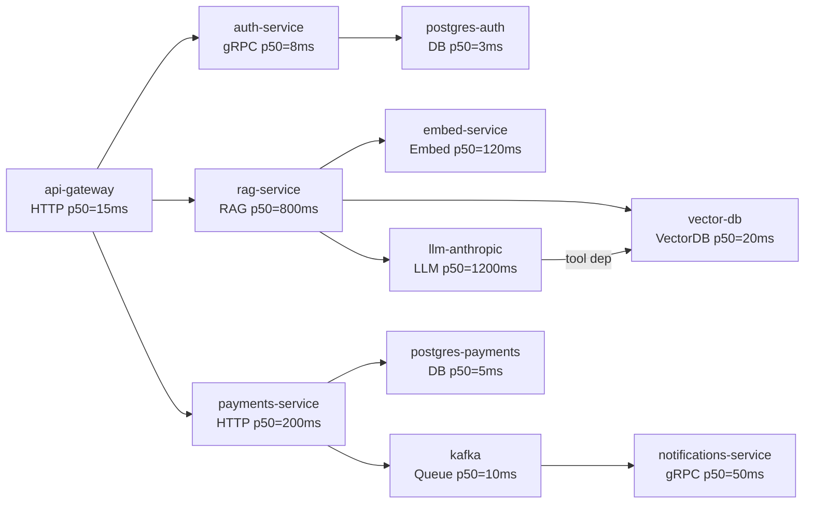
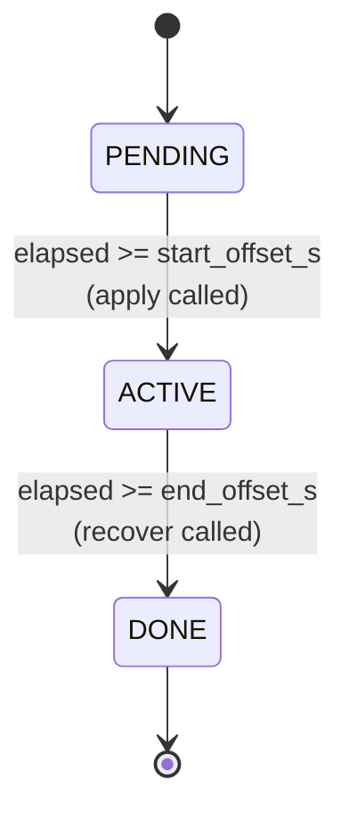
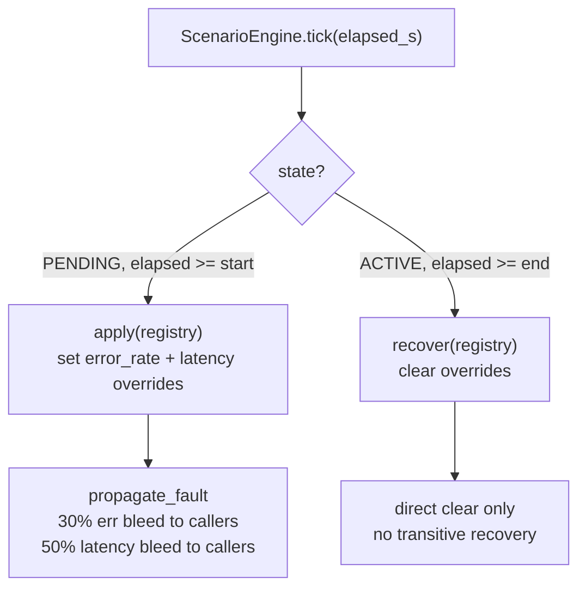

# genai-observability-data

A synthetic observability data generator that produces realistic distributed traces and structured logs
for GenAI-powered systems, following the [OpenTelemetry GenAI Semantic Conventions](https://opentelemetry.io/docs/specs/semconv/gen-ai/)
(semconv 1.41.0, experimental).

Use it to populate an OTel stack (Jaeger + Loki + Grafana + Prometheus) with representative data for
dashboarding, alerting rule development, anomaly detection, or testing observability tooling against
GenAI workloads - without needing a live production system.

```
god --traces 500 --scenario rag_meltdown --otlp http://localhost:4318
      |
      +-- ScenarioEngine   (time-bounded fault injection)
      |       |
      |       +-- db_degradation / llm_latency_spike / provider_failover / ...
      |
      +-- ServiceRegistry  (11-service topology with dependency graph)
      |
      +-- generate_dataset (Trace + LogEntry per virtual request)
      |       |
      |       +-- api-gateway root span
      |       +-- auth-service + postgres-auth
      |       +-- RAG path: embed -> vector-db -> llm-anthropic (+ tool/MCP)
      |       +-- payments path: payments-service -> postgres-payments + kafka
      |
      +-- Sinks: stdout | FileSink | OTLPHttpSink | MultiSink
      |
      +-- Optional: scenario_agent (pydantic-ai, claude-haiku)
                    analyses batch -> ScenarioAnalysis
```

---

## Contents

- [Objective](#objective)
- [Architecture](#architecture)
- [Prerequisites](#prerequisites)
- [Installation](#installation)
- [Configuration](#configuration)
- [Quick start](#quick-start)
- [CLI reference](#cli-reference)
- [Root CLI (god)](#root-cli-god)
- [Scenarios](#scenarios)
- [OTel stack (Docker)](#otel-stack-docker)
- [Output formats](#output-formats)
- [Running tests](#running-tests)
- [Evaluation / analysis agent](#evaluation--analysis-agent)
- [Project structure](#project-structure)
- [Make targets](#make-targets)
- [Extending](#extending)
- [Gotchas](#gotchas)

---

## Objective

Real GenAI traces are hard to get at scale for tooling development. This project generates a
multi-service system (API gateway, RAG service, LLM inference, embedding, vector DB, payments, auth)
with controllable fault scenarios injected at precise moments. You get:

- OTLP-compatible trace JSON (spans with correct parent-child relationships, timing, attributes)
- Structured logs correlated to traces by `trace_id`
- Loki-compatible log push format
- Anomaly signals strong enough to trigger real alerting rules
- A pydantic-ai agent that analyses the batch and returns a `ScenarioAnalysis` with per-service signals

---

## Architecture

### Service topology

Eleven services, fully wired with dependency edges and latency profiles:



Latency is sampled from a lognormal distribution derived from each service's p50/p99 profile. Error
rates are per-service baselines, overridden by the active scenario.

### Trace structure

Each generated trace represents one incoming request. The orchestrator always builds:

1. `api-gateway` root span (HTTP SERVER)
2. `auth-service` + `postgres-auth` sub-trace (every request)
3. RAG path (~65% of requests): `embed-service` -> `vector-db` -> `llm-anthropic` (+ 25% chance of a
   tool or MCP tool span as a child of the LLM span)
4. Payments path (~65% of requests): `payments-service` -> `postgres-payments` + `kafka` -> `notifications-service`

Approximately 30% of requests traverse both paths.

### Scenario engine

Scenarios are time-bounded fault injectors. Each scenario defines a `start_offset_s`, `end_offset_s`,
`apply(registry)` callable, and `recover(registry)` callable. The engine ticks once per virtual second
of generated time and transitions scenarios through `PENDING -> ACTIVE -> DONE`.

Fault propagation: when a downstream service is degraded, its immediate upstream callers inherit 30% of
the error rate increase and 50% of the latency multiplier (one hop only, not transitive).



### GenAI span attributes

All LLM inference spans follow OTel GenAI semconv. Key attributes:

| Attribute | Example | Notes |
|-----------|---------|-------|
| `gen_ai.system` | `anthropic` | Provider |
| `gen_ai.operation.name` | `chat` | GenAIOperation enum |
| `gen_ai.request.model` | `claude-sonnet-4-20250514` | |
| `gen_ai.request.max_tokens` | `4096` | Random choice: 1024/2048/4096/8192 |
| `gen_ai.usage.input_tokens` | `1204` | |
| `gen_ai.usage.output_tokens` | `312` | 0 on error |
| `gen_ai.response.finish_reasons` | `["stop"]` | `"length"` = token truncation |
| `gen_ai.server.time_to_first_token` | `0.412` | Seconds (OTel spec) |
| `gen_ai.server.ttft_ms` | `412.3` | Milliseconds (convenience, non-standard) |
| `gen_ai.client.operation.duration` | `2340.1` | Full span duration in ms |

A `gen_ai.content.first_token` SpanEvent is added at the TTFT offset on successful inference spans.

---

## Prerequisites

| Tool | Version | Purpose |
|------|---------|---------|
| Python | 3.12+ | Runtime |
| [uv](https://docs.astral.sh/uv/) | latest | Package manager |
| Docker Desktop | latest | OTel stack (Jaeger, Loki, Grafana, Prometheus) |
| Anthropic API key | - | Analysis agent only (not needed for data generation) |

The data generator itself has no API key requirement. An `ANTHROPIC_API_KEY` is only needed when
running `--analyse` without `--mock`.

---

## Installation

```bash
git clone <repo-url>
cd genai-observability-data/src/god
uv sync --all-extras
```

Or from the repo root:

```bash
make install
```

This creates `src/god/.venv/` and installs all runtime and dev dependencies.

---

## Configuration

Settings are read from environment variables or a `.env` file placed in `src/god/` (the working
directory when the package runs).

Create your `.env`:

```bash
cp src/god/.env.example src/god/.env   # if the example exists
# or create manually:
cat > src/god/.env <<'EOF'
ANTHROPIC_API_KEY=sk-ant-...
GOD_MOCK_MODE=false
EOF
```

### All settings

| Variable | Default | Required | Description |
|----------|---------|----------|-------------|
| `ANTHROPIC_API_KEY` | - | Yes, for `--analyse` without `--mock` | claude-haiku analysis agent |
| `GOD_MOCK_MODE` | `false` | No | Replace all LLM calls with deterministic mock |
| `GOD_AGENT_MODEL` | `claude-haiku-4-5-20251001` | No | Model for the analysis agent |
| `GOD_DEFAULT_TRACES` | `100` | No | CLI default when `--traces` is omitted |
| `GOD_DEFAULT_RATE` | `10.0` | No | CLI default traces/second |
| `GOD_DEFAULT_BATCH_SIZE` | `50` | No | Flush batch size |

No Elasticsearch, Redis, or Google API keys are used by this project.

---

## Quick start

### Generate and print logs to stdout (no Docker, no API key)

```bash
cd src/god
uv run python -m god --traces 20 --mock
```

### Stream to a local OTel stack

```bash
# Start Jaeger + Loki + Grafana + Prometheus
make stack-up

# Stream 500 traces of a cascading failure scenario
make demo-scenario SCENARIO=cascading_failure TRACES=500

# Open Grafana
open http://localhost:3000
# Open Jaeger
open http://localhost:16686
```

### Write files in all formats

```bash
cd src/god
uv run python -m god --traces 200 --output ./output --format otlp_traces otlp_logs logfmt loki
```

---

## CLI reference

```
usage: god [-h] [--traces N] [--rate RATE] [--scenario PRESET]
           [--seed SEED] [--capture-content]
           [--format FORMAT [FORMAT ...]] [--output DIR]
           [--otlp URL] [--otlp-header KEY=VALUE]
           [--compress] [--batch-size N]
           [--analyse] [--agent-model MODEL] [--mock]
           [--list-scenarios] [--quiet] [--version]
```

#### Generation

| Argument | Default | Description |
|----------|---------|-------------|
| `--traces`, `-n` | `GOD_DEFAULT_TRACES` | Number of traces to generate |
| `--rate` | `GOD_DEFAULT_RATE` | Target traces per second (virtual time) |
| `--scenario` | (none) | Fault scenario preset name |
| `--seed` | (none, non-deterministic) | RNG seed for reproducible output |
| `--capture-content` | off | Include `gen_ai.input.messages` and `gen_ai.output.messages` |

#### Output

| Argument | Default | Description |
|----------|---------|-------------|
| `--format` | `otlp_traces otlp_logs logfmt` | One or more output formats |
| `--output`, `-o` | (none) | Write files to this directory |
| `--otlp` | (none) | POST to this OTLP HTTP endpoint |
| `--otlp-header` | (none, repeatable) | Extra headers, e.g. `Authorization=Bearer ...` |
| `--compress` | off | Gzip output files |
| `--batch-size` | `GOD_DEFAULT_BATCH_SIZE` | Flush every N traces |

Sink selection: `--output` -> FileSink, `--otlp` -> OTLPHttpSink, both -> MultiSink, neither -> StdoutSink.

#### Analysis agent

| Argument | Default | Description |
|----------|---------|-------------|
| `--analyse` | off | Run the pydantic-ai agent on the generated batch |
| `--agent-model` | `GOD_AGENT_MODEL` | Override the analysis model |
| `--mock` | off | Use deterministic FunctionModel instead of calling Anthropic |

#### Meta

| Argument | Description |
|----------|-------------|
| `--list-scenarios` | Print scenario table and exit |
| `--quiet`, `-q` | Suppress progress output |
| `--version`, `-V` | Print version and exit |

### Examples

```bash
# 1000 traces, deterministic, quiet, written as OTLP + logfmt
uv run python -m god -n 1000 --seed 42 --output ./data/fixtures -q \
  --format otlp_traces otlp_logs logfmt loki

# Stream a specific scenario to a local collector with a bearer token
uv run python -m god -n 500 --scenario rag_meltdown --rate 5 \
  --otlp http://collector:4318 \
  --otlp-header "Authorization=Bearer mytoken"

# Run the analysis agent in mock mode (no API key needed)
uv run python -m god -n 100 --scenario llm_degradation --mock --analyse

# List all available scenarios
uv run python -m god --list-scenarios
```

---

## Root CLI (god)

The repo root ships a standalone `god` script that wraps the package with a Rich terminal UI. It
requires no installation beyond the existing `uv` environment - just run it from the repo root.

```bash
# From the repo root (no cd required)
./god --help
./god --list-scenarios
./god -n 50 --mock
./god -n 500 --scenario cascading_failure --mock -o ./output --format otlp_traces otlp_logs logfmt
./god -n 200 --scenario llm_degradation --mock --analyse
```

The script resolves `src/god` via `sys.path` automatically, so it works without activating the venv
or installing the package as an entry point.

### What the root CLI adds over `python -m god`

| Feature | `python -m god` | `./god` |
|---------|----------------|---------|
| Output | Plain stderr progress | Rich panels, progress bar, colour |
| `--help` | argparse default | Formatted table with grouped options |
| `--list-scenarios` | Plain text | Rich table with tags and descriptions |
| Analysis output | Plain print | Severity-coloured anomaly signal panel |
| Run config | Inline log line | Pre-run configuration panel |

The underlying generation logic, all flags, and all defaults are identical. Use `./god` for
interactive terminal sessions; use `python -m god` (or the `god` entry point) in scripts and CI.

### Quiet / pipe mode

`--quiet` (`-q`) suppresses all Rich output to stderr. Stdout stays clean data, suitable for piping:

```bash
./god -n 1000 --mock -q | grep "level=ERROR" | wc -l
```

---

## Scenarios

Run `python -m god --list-scenarios` for the current table. Built-in presets:

| Preset | Description | Services affected | Duration |
|--------|-------------|------------------|----------|
| `db_incident` | DB connection pool exhaustion (40% errors, 8x latency) | postgres-payments | 60-300s |
| `llm_degradation` | LLM latency spike + token truncations | llm-anthropic | overlapping windows |
| `rag_meltdown` | Vector DB slow + LLM spike + provider failover (95% errors) | vector-db, llm-anthropic | 3 staggered faults |
| `payment_outage` | Payments errors (60%) + DB degradation | payments-service, postgres-payments | two faults |
| `cascading_failure` | Auth DB -> auth outage -> payments cascade -> LLM spike | 4 services, chained | 4 staggered faults |
| `quiet` | No faults injected | - | - |

Pass a scenario with `--scenario <preset>`. Fault injection uses virtual time, not wall time, so
trace count determines how much of the scenario you observe.

### How fault injection works



The `token_budget_breach` scenario is special: it sets `_error_rate_override = 0.0` (suppressing
baseline errors entirely). The truncation signal comes from a separate 5% random chance in
`build_inference_span`, independent of the error rate.

---

## OTel stack (Docker)

The included `docker-compose.yml` starts a complete observability stack:

| Service | Port | UI |
|---------|------|----|
| OTel Collector (OTLP HTTP) | 4318 | - |
| OTel Collector (OTLP gRPC) | 4317 | - |
| Jaeger | 16686 | http://localhost:16686 |
| Loki | 3100 | (API only) |
| Grafana | 3000 | http://localhost:3000 (admin/admin) |
| Prometheus | 9090 | http://localhost:9090 |

Grafana datasources (Jaeger, Loki, Prometheus) are auto-provisioned. No dashboards are provisioned
by default - you need to build them or import community dashboards.

```bash
make stack-up       # start all services
make stack-down     # stop all services
make stack-reset    # stop + wipe all volumes
make stack-logs     # tail collector + loki logs
```

Collector pipeline: OTLP receive -> batch (1s / 1024 spans) + memory_limiter (512 MiB) -> Jaeger
(traces) + Loki (logs). Prometheus scrapes collector self-metrics on `:8888`.

---

## Output formats

| Format | File | Description |
|--------|------|-------------|
| `otlp_traces` | `traces.otlp.jsonl` | One OTLP `resourceSpans` JSON object per line |
| `otlp_logs` | `logs.otlp.jsonl` | One OTLP `resourceLogs` JSON object per line |
| `logfmt` | `logs.logfmt` | Human-readable logfmt, one log per line |
| `loki` | `logs.loki.jsonl` | Loki push API format, grouped by service |

All file outputs append by default across multiple `flush()` calls. Use `--compress` to write `.gz`
files (gzip append mode, not seek-rewrite).

### OTLP traces structure

```json
{
  "resourceSpans": [
    {
      "resource": {"attributes": [{"key": "service.name", "value": {"stringValue": "rag-service"}}]},
      "scopeSpans": [{
        "scope": {"name": "synthetic.rag-service"},
        "spans": [{ "traceId": "...", "spanId": "...", ... }]
      }]
    }
  ]
}
```

Int attributes are serialised as `{"intValue": "1234"}` (string, per OTLP JSON spec).

---

## Running tests

All tests are in `src/god/tests/`. The test suite requires no API keys or running services.

```bash
# From src/god/
uv run pytest

# With coverage
uv run pytest --cov=. --cov-report=term-missing

# Single module
uv run pytest tests/test_generators.py -v

# Via make
make test           # full suite with coverage
make test-unit      # alias
```

`pytest.ini_options` are configured in `src/god/pyproject.toml`:
- `asyncio_mode = "auto"` - all async test functions run automatically (no `@pytest.mark.asyncio`)
- `pythonpath = [".."]` - imports resolve as `from god.models import ...`
- `addopts = "-v --tb=short"`

### Test patterns

- All LLM calls use the `autouse` fixture in `test_agent.py` that calls `activate_mock_mode()` /
  `deactivate_mock_mode()` around each test. No `ALLOW_MODEL_REQUESTS` guard is needed separately.
- Deterministic generation: pass `rng_seed=42` (or any int) to `generate_dataset` to get identical
  output on every run. Omit to get non-deterministic output.
- Mock mode can be tested at the CLI level: `GOD_MOCK_MODE=true uv run python -m god -n 5`

### What each test file covers

| File | Tests | Focus |
|------|-------|-------|
| `test_models.py` | 11 | Serialisation: Span/Trace/LogEntry -> OTLP/Loki/logfmt |
| `test_services.py` | 12 | LatencyProfile math, fault overrides, propagation, registry |
| `test_scenarios.py` | 16 | State machine, fault lifecycle, presets, `from_preset` |
| `test_generators.py` | 20 | Span builders, TTFT event, content capture, RAG trace shape |
| `test_orchestrator.py` | 12 | End-to-end trace assembly, dataset yield count, log correlation |
| `test_sinks.py` | 14 | File formats, gzip, append, OTLP HTTP (mocked), multi-sink |
| `test_agent.py` | 5 | Analysis agent, mock mode, severity signals |

---

## Evaluation / analysis agent

The optional `--analyse` flag runs a pydantic-ai agent against the generated batch. The agent returns
a `ScenarioAnalysis` with structured anomaly signals.

```python
@dataclass
class AnomalySignal:
    service: str
    signal_type: str   # error_spike | latency_spike | token_truncation | tool_failure
    severity: str      # low | medium | high | critical

@dataclass
class ScenarioAnalysis:
    active_scenarios: list[str]
    anomaly_signals: list[AnomalySignal]
    error_rate: float
    p99_latency_ms: float
    recommended_action: str
    summary: str
```

The agent is invoked with a pre-computed summary (total spans, error rate, p99 latency, per-service
error counts, token truncations, tool failures). It uses `claude-haiku-4-5-20251001` by default.

### Running without an API key

Pass `--mock` to activate a deterministic `FunctionModel` that replicates the analysis logic locally:

```bash
uv run python -m god -n 200 --scenario cascading_failure --mock --analyse
```

### Model override

```bash
uv run python -m god -n 200 --analyse --agent-model claude-sonnet-4-20250514
# or via .env:
GOD_AGENT_MODEL=claude-sonnet-4-20250514
```

---

## Project structure

```
genai-observability-data/
  Makefile                         # Root build/run targets (primary)
  docker-compose.yml               # OTel stack: Collector + Jaeger + Loki + Grafana + Prometheus
  infra/
    otel-collector-config.yaml     # Collector pipeline config
    prometheus.yml                 # Scrape config (collector self-metrics)
    grafana/provisioning/
      datasources/datasources.yaml # Auto-provisioned Jaeger + Loki + Prometheus
  tasks/
    plan.md                        # Refactor plan (package path flattening, in progress)
    todo.md                        # Task checklist for the flatten
  tests/
    test_sample.py                 # Placeholder (root-level)
  src/
    god/                           # The real package root
      pyproject.toml               # Canonical package declaration
      Makefile                     # Convenience wrapper
      uv.lock                      # Pinned dependencies
      __init__.py                  # Public API + __version__
      __main__.py                  # CLI entry point (python -m god)
      agent.py                     # pydantic-ai analysis agent + ScenarioAnalysis model
      config.py                    # Settings (pydantic-settings, reads .env)
      deps.py                      # GodDeps dependency injection container
      models.py                    # Span, Trace, LogEntry, enums, OTLP serialisation
      orchestrator.py              # generate_trace + generate_dataset
      scenarios.py                 # ScenarioEngine, Scenario, 8 built-in fault presets
      services.py                  # ServiceRegistry, ServiceDef, LatencyProfile
      sinks.py                     # StdoutSink, FileSink, OTLPHttpSink, MultiSink
      py.typed                     # PEP 561 marker
      generators/
        genai.py                   # GenAI span builders (inference, embedding, retrieval, tool, MCP)
        infra.py                   # Infra span builders (HTTP, gRPC, DB, queue) + log generators
      mock/
        activate.py                # Process-level mock activation via agent.override()
        models.py                  # Deterministic FunctionModel for the analysis agent
      tests/
        test_agent.py
        test_generators.py
        test_models.py
        test_orchestrator.py
        test_scenarios.py
        test_services.py
        test_sinks.py
```

---

## Make targets

Run `make help` from the repo root. Key targets:

| Target | Description |
|--------|-------------|
| `make install` | `uv sync --all-extras` in `src/god/` |
| `make test` | Full test suite with coverage |
| `make test-unit` | Alias for `make test` |
| `make lint` | Ruff lint + autofix |
| `make format` | Ruff format |
| `make typecheck` | mypy |
| `make ci` | format + lint + typecheck + test |
| `make gen` | 100 traces to stdout (mock mode, no API key needed) |
| `make gen-files` | OTLP + logfmt to `./output/` |
| `make gen-otlp` | Stream to `http://localhost:4318` (requires API key or `GOD_MOCK_MODE=true`) |
| `make gen-fixtures` | 200 traces, seed=42, all formats -> `./data/fixtures/` |
| `make gen-scenario SCENARIO=<name>` | Run a named scenario |
| `make list-scenarios` | Print scenario table |
| `make stack-up` | Start OTel stack (Docker), polls health |
| `make stack-down` | Stop OTel stack |
| `make stack-reset` | Stop + wipe volumes |
| `make demo` | stack-up + gen-otlp |
| `make demo-scenario SCENARIO=cascading_failure` | stack-up + 500 traces of scenario at rate=5 |
| `make build` | Build sdist + wheel |
| `make publish-test` | Publish to TestPyPI |
| `make publish` | Publish to PyPI |

---

## Extending

### Adding a new scenario

Add a factory function to `src/god/scenarios.py` following the existing pattern, then register it in
`SCENARIO_PRESETS`. The function receives a `ServiceRegistry` and returns a `list[Scenario]`.

```python
def my_scenario(registry: ServiceRegistry) -> list[Scenario]:
    def apply(r: ServiceRegistry) -> None:
        r.propagate_fault("my-service", error_rate=0.5, latency_multiplier=3.0)

    def recover(r: ServiceRegistry) -> None:
        r.get("my-service")._error_rate_override = None
        r.get("my-service")._latency_multiplier = 1.0

    return [Scenario(
        name="my_scenario",
        description="...",
        start_offset_s=30,
        end_offset_s=180,
        apply=apply,
        recover=recover,
        tags={"my_tag"},
    )]

SCENARIO_PRESETS["my_preset"] = my_scenario
```

### Adding a new span builder

Add a function to `src/god/generators/genai.py` or `src/god/generators/infra.py` with the signature:

```python
def build_my_span(
    svc: ServiceDef,
    trace_id: str,
    parent_span_id: str | None,
    start_ms: float,
    rng: np.random.Generator,
) -> tuple[Span, float]:
    ...
    return span, end_ms
```

Then call it from `orchestrator.py` where appropriate.

### Adding a new output sink

Subclass `Sink` from `src/god/sinks.py`:

```python
class MySink(Sink):
    def flush(self, traces: list[Trace], logs: list[LogEntry]) -> None:
        ...

    def close(self) -> None:
        ...
```

### Changing the service topology

Edit `src/god/services.py`. Add a `ServiceDef` to `_DEFAULT_SERVICES` and wire up dependencies in
`_DEFAULT_DEPS`. Existing tests assert on specific service names - update `test_services.py`
accordingly.

---

## Gotchas

1. **Entry point is `src/god/__main__.py`, not `src/__main__.py`.** The root `src/__main__.py` is a
   stale file that imports from `synthetic_logs.*` (an old package name) and should not be used. Always
   run `python -m god` from inside `src/god/` or use `uv run python -m god` which resolves the venv
   correctly.

2. **`gen-otlp` requires an API key (or mock mode).** The make target does not set `GOD_MOCK_MODE=true`
   unlike `gen`, `gen-files`, and `gen-fixtures`. If you have not set `ANTHROPIC_API_KEY` and are not
   in mock mode, the analysis agent will fail on `--analyse`. Pure generation without `--analyse` works
   fine without any API key.

3. **Seed only partially controls randomness.** A few choices inside the generators (HTTP method
   selection, some error type strings) use `random.choice` from the stdlib without seeding. For fully
   reproducible output, call `random.seed(n)` yourself before invoking `generate_dataset`.

4. **`gen_ai.server.time_to_first_token` is in seconds (OTel spec); `gen_ai.server.ttft_ms` is a
   non-standard convenience attribute in milliseconds** emitted alongside it. Do not treat them as
   duplicates when writing dashboards.

5. **Token budget breach suppresses baseline errors.** `_error_rate_override = 0.0` means the service
   emits zero hard errors during that scenario window. The anomaly signal is purely in
   `finish_reason=length` spans, not in span status.

6. **OTLPHttpSink is synchronous.** It uses `urllib.request`, not httpx. Large batches will block the
   main thread. Use a small `--batch-size` if this is a concern.

7. **Grafana has no dashboards provisioned.** Datasources are auto-wired. You must build or import
   dashboards manually after `make stack-up`.

8. **`int` attribute values are serialised as strings in OTLP JSON** per the OTLP spec:
   `{"intValue": "1234"}`. Some downstream consumers may need this handled explicitly.

9. **The `tasks/` refactor plan** describes flattening `src/god/god/` -> `src/god/`. The file system
   already reflects the flat layout. If you encounter import errors referencing a double-nested path,
   the plan is stale.
