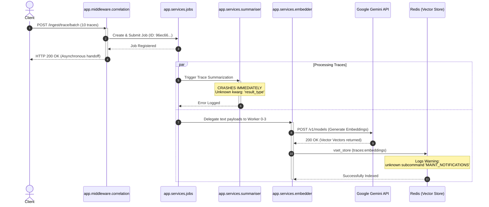

Based on a comprehensive review of the provided execution log, here is an in-depth analysis of your FastAPI system (`vecstore-api`). The application is a specialized GenAI observability service running locally that parses, embeds, and indexes telemetric data (traces and logs).

---

## ## 1. System Architecture & Flow Analysis

The system handles incoming observability batches using an asynchronous architecture decoupled into background workers and event watchers.

### ### Data Flow Sequence Diagram

The diagram below illustrates the ingestion pipeline, highlighting where things succeed and where they crash:

---

## ## 2. Deep Insights & Critical Vulnerabilities

An analysis of the state changes and execution errors reveals four distinct issues within the runtime environment:

### ### Issue 1: Code Regression in LLM Summarizer (Critical)

* **Symptom:** `llm_summarise_trace_failed [app.services.summariser] error='Unknown keyword arguments: result_type'`
* **Deep Insight:** The application attempts to leverage an LLM orchestration layer (such as LangChain, PydanticAI, or the native Google GenAI SDK) to compress and summarize trace lifecycles. However, a parameter named `result_type` is being passed to an execution method that does not support it.
* **Root Cause:** This usually points to a recent library update where code was deployed using newer SDK syntax (e.g., PydanticAI structured outputs) but the local environment is pinned to an older version of the library, or vice versa (a parameter was deprecated and completely removed).
* **Impact:** The trace summarization engine is completely broken. It exits immediately every time a batch is processed.

### ### Issue 2: Broken OpenTelemetry Context Propagation (Observability Blindspot)

* **Symptom:** Throughout the entire transaction lifecycle, every single worker log notes `trace_id=-`.
* **Deep Insight:** Despite the log indicating that OpenTelemetry was initialized successfully at boot (`otel_configured endpoint=http://otel-collector:4317`), the application fails to propagate standard telemetry headers internally.
* **Root Cause:** The `app.middleware.correlation` layer captures incoming `request_id`, but when tasks are handed off to `app.services.jobs` or processing threads inside `app.services.embedder`, the OpenTelemetry context is dropped.
* **Impact:** If an error occurs deep inside a background thread, you will have no automated pattern-matching ability to link that database or worker error back to the web request that initiated it.

### ### Issue 3: Redis Client-Server Subcommand Incompatibility

* **Symptom:** `Failed to enable maintenance notifications: unknown subcommand 'MAINT_NOTIFICATIONS'. Try CLIENT HELP. [redis.connection]`
* **Deep Insight:** The client-side library (potentially an enterprise-grade Redis wrapper or an AI-caching library) is attempting to execute `CLIENT MAINT_NOTIFICATIONS` during connection handshakes.
* **Root Cause:** The application is connecting to a standard vanilla Redis instance (`redis://localhost:6379`). Standard open-source Redis does not support the enterprise-tier cloud subcommands used for scaling/maintenance hooks.
* **Impact:** Low runtime degradation but high log noise. It floods your console with debug logs on almost every major interaction block.

### ### Issue 4: Synchronous Network Footprint on Async Workers

* **Symptom:** `connect_tcp.complete return_value=<httpcore._backends.sync.SyncStream object...>`
* **Deep Insight:** The system relies on `httpcore` to manage connections out to `generativelanguage.googleapis.com`. The presence of `SyncStream` indicates that the networking layer is executing **synchronous (blocking)** requests under the hood rather than leveraging non-blocking `AsyncStream` constructs.
* **Impact:** Even though you have configured 4 embedding workers (`workers=4`), they will block execution threads while waiting for Google's API to respond over WAN, capping ingestion throughput.

---

## ## 3. Execution Timeline Breakdown

| Timestamp (Z) | Component | Log Level | Action/Insight |
| --- | --- | --- | --- |
| **10:58:15.181** | `app.main` | INFO | OpenTelemetry collector targets `otel-collector:4317`. |
| **10:58:18.067** | `redis.connection` | DEBUG | Initial Redis compatibility failure occurs. |
| **10:58:18.177** | `ttl_watcher` | INFO | Key eviction notifications enabled via payload configurations (`xE`). |
| **10:59:23.021** | `services.jobs` | DEBUG | Ingestion batch splits into jobs: Tracking Job `96ec6629` (10 traces). |
| **10:59:23.049** | `services.summariser` | **ERROR** | **Summarizer pipeline fails due to invalid syntax.** |
| **10:59:23.052** | `httpcore` | DEBUG | Outbound handshake initialized with Google Gemini endpoint. |
| **10:59:23.469** | `vectorstore` | DEBUG | First trace embedding successfully saved to Redis (`traces:embeddings`). |
| **10:59:25.112** | `vectorstore` | DEBUG | Ingestion pipeline hits 6 vector stored structures before log truncation. |

---

## ## 4. Recommended Action Items

> 1. **Fix the Parameter Conflict:** Inspect `app/services/summariser.py` around the LLM invocation code block. Remove or fix the `result_type` argument depending on your target LLM client library specifications.
> 2. **Refactor Http Client to Async:** Switch your Google Client/HTTP invocation framework from standard synchronous bindings to an asynchronous variation (e.g., swapping `httpx.Client` for `httpx.AsyncClient`) to replace the blocking `SyncStream` behavior.
> 3. **Fix Context Propagation:** Ensure that when background tasks are dispatched, you wrap your execution targets with OpenTelemetry's context propagation helpers (e.g., `context.attach()`) so `trace_id` is retained across thread boundaries.
> 4. **Suppress Redis Logs:** Silence the Redis debug noise by disabling custom maintenance hooks or aligning client configuration parameters with standard open-source Redis syntax.
> 
>